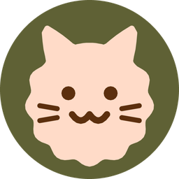
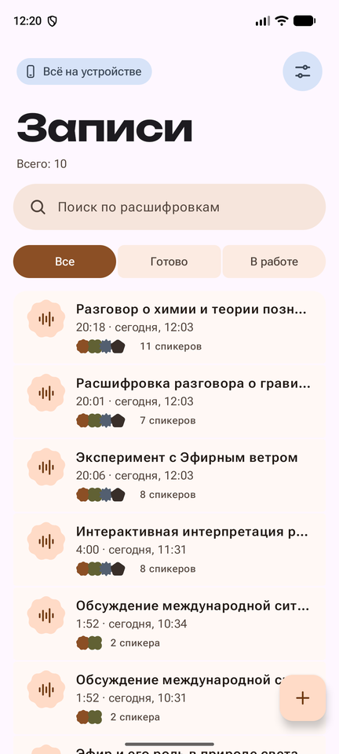
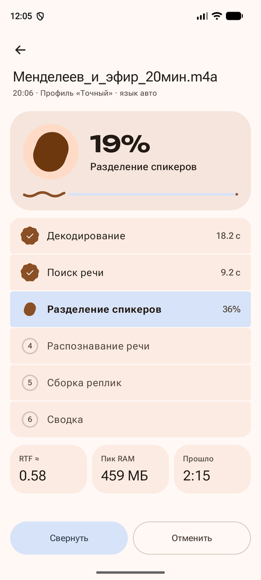
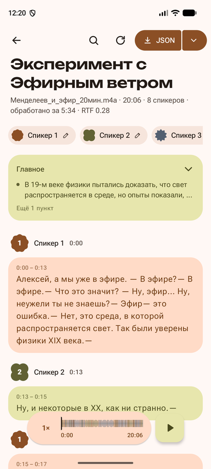
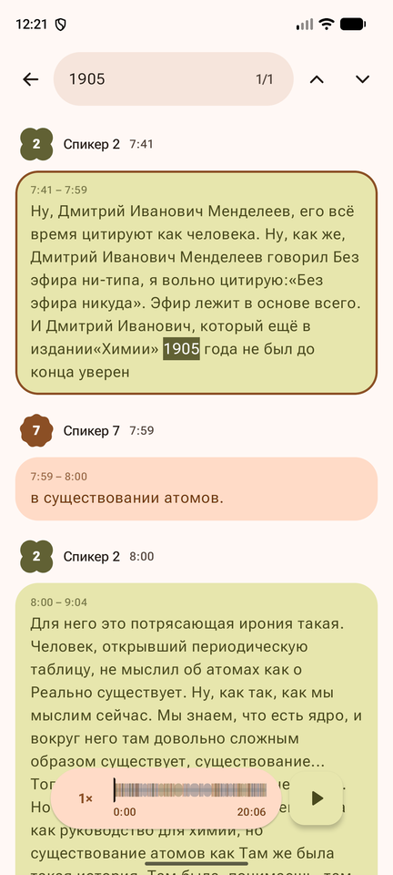
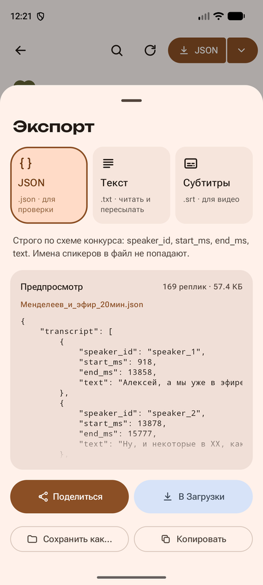
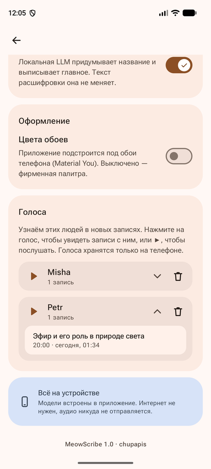
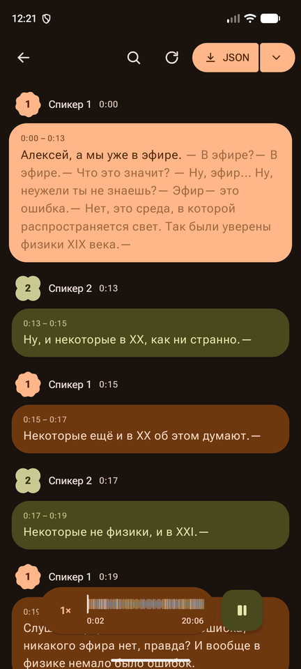

<p align="center"></p>

<h1 align="center">MeowScribe — нейро-стенографист</h1>

Android-приложение, которое **полностью на устройстве** превращает запись разговора в текст. Оно распознаёт речь, разделяет реплики по говорящим, проставляет временные метки и экспортирует результат в JSON по схеме кейса. Интернет не нужен: в манифесте нет разрешения `INTERNET`, все модели встроены в APK.

Nuclear IT Hack 2026, кейс «Нейро-стенографист», команда **chupapis**: [@lapcevichme](https://github.com/lapcevichme) — приложение и UX, [@oatis123](https://github.com/oatis123) — ML-пайплайн.

<p align="center">
  
  
  
  
</p>
<p align="center">
  
  
  
</p>

## Отчётные материалы

| # | Материал | Где |
| :---: | :--- | :--- |
| 1 | APK (arm64-v8a + x86_64, ~1.1 ГБ) | [GitHub Releases](https://github.com/lapcevichme/meow-scribe/releases/latest) |
| 2 | Исходный код | [`android/`](android/) — приложение, [`bench/`](bench/) — Python-стенд пайплайна, [`scripts/`](scripts/) — загрузка моделей |
| 3 | Инструкция по установке и использованию | этот README: [установка](#установка), [как пользоваться](#как-пользоваться), [сборка](#сборка-из-исходников) |
| 4 | Архитектура и модели | [`docs/ARCHITECTURE.md`](docs/ARCHITECTURE.md) |
| 5 | Ограничения | [`docs/LIMITATIONS.md`](docs/LIMITATIONS.md) |
| 6 | Результаты тестов | [`docs/TEST_RESULTS.md`](docs/TEST_RESULTS.md), [`artifacts/test-results/`](artifacts/test-results/), все замеры в [`bench/README.md`](bench/README.md) |
| 7 | Видеодемонстрация | [Google Drive](https://drive.google.com/drive/folders/1pJ6H2zaZ7F9Aie6crc3N3rVtT1odSDUV?usp=sharing), копия в [`artifacts/demo/`](artifacts/demo/README.md) |

## Установка

APK весит около 1.1 ГБ: внутри все модели (ASR, диаризация, LLM). В git он не помещается, поэтому лежит в Releases.

```bash
adb install -r app-release.apk
```

Требования:
- Android 9+ (minSdk 28);
- arm64-v8a или x86_64;
- от 3 ГБ RAM (проверено на эмуляторе с 4 ГБ, пиковое потребление при обработке около 300 МБ, с LLM до ~800 МБ).

## Как пользоваться

1. **Импорт.** На главном экране «Импортировать файлы» (или «+» → «Импорт файлов»). Можно выбрать сразу несколько файлов. Подходит всё, что декодирует Android: WAV, MP3, M4A/AAC, OGG/Opus, FLAC, звук из MP4. Ещё можно «Поделиться» аудио из другого приложения или открыть файл через «Открыть с помощью». Есть и запись с микрофона.
2. **Обработка** начинается сразу и идёт по очереди в фоне, прогресс по стадиям виден на экране и в уведомлении. Пока идёт обработка, приложение можно свернуть.
3. **Расшифровка.** Реплики сгруппированы по спикерам и показаны с временем. Нажмите на реплику, и плеер перейдёт к ней. При воспроизведении подсвечивается текущее слово. Сверху есть сводка от локальной LLM: название, краткое содержание и ключевые пункты. Что ещё можно сделать:
   - искать по тексту;
   - переименовать спикера и запомнить его голос;
   - отредактировать, разделить или объединить реплики;
   - обработать запись заново с другими настройками.
4. **Экспорт.** Кнопка **JSON** в верхней панели сразу сохраняет файл в `Загрузки/MeowScribe/`. В меню рядом с ней есть TXT и SRT, а также «Поделиться» и «Сохранить как…».

Формат JSON строго по ТЗ:

```json
{"transcript":[{"speaker_id":"speaker_1","start_ms":1250,"end_ms":4380,"text":"Добрый день, коллеги."}]}
```

`speaker_id` — `speaker_1`, `speaker_2`, … в порядке первого появления. `start_ms` и `end_ms` — целые миллисекунды от начала файла. Имена, которые пользователь дал спикерам, в основной экспорт не попадают, чтобы схема не менялась.

### Настройки

| Настройка | По умолчанию | Что делает |
| :--- | :--- | :--- |
| Профиль | Точный | «Быстрый» мельче шагает окном диаризации: RTF примерно на 30% ниже, DER чуть хуже. WER одинаковый |
| Язык | Авто | Русский, английский или автоопределение по whisper-tiny |
| Число спикеров | Авто | Если известно заранее, диаризация точнее |
| Сводка LLM | Вкл. | Название и резюме разговора. Текст транскрипта LLM не меняет |
| Цвета обоев | Выкл. | Material You из обоев вместо фирменной палитры (Android 12+) |
| Голоса | — | Сохранённые голоса: записи, где встречается человек, и фрагмент его речи |

## Для автоматической проверки

| | |
| :--- | :--- |
| Пакет | `com.lapcevichme.meowscribe` |
| Activity | `com.lapcevichme.meowscribe/.MainActivity` |
| Импорт без UI | `ACTION_VIEW` или `ACTION_SEND` / `ACTION_SEND_MULTIPLE` с `content://` URI и MIME `audio/*` |
| Где результат | `/sdcard/Download/MeowScribe/<имя записи>.json` (после нажатия **JSON**) |
| Сеть | не используется, разрешения `INTERNET` нет |

```bash
# открыть файл из медиатеки (id — из content://media/external/audio/media/<id>)
adb shell am start --grant-read-uri-permission -a android.intent.action.VIEW \
  -d content://media/external/audio/media/<id> -t audio/wav \
  -n com.lapcevichme.meowscribe/.MainActivity
# забрать экспорт
adb pull /sdcard/Download/MeowScribe/
```

## Сборка из исходников

Нужны Android SDK, `curl` и `bzip2`. JDK для Gradle-демона (25), NDK r28 и CMake 3.22.1 Gradle скачает сам.

```bash
./scripts/fetch_models.sh            # ~1 ГБ весов → android/app/src/main/assets/models/ (в git их нет)
cd android
./gradlew :app:assembleRelease       # → app/build/outputs/apk/release/app-release.apk
./gradlew :app:testDebugUnitTest     # юнит-тесты
```

Исходники llama.cpp скачиваются при первой сборке в `android/llama/third_party/`. Если нет `android/keystore.properties`, release подписывается debug-ключом и ставится без дополнительных шагов.

Python-стенд пайплайна (те же модели и та же логика, что в приложении, плюс метрики) описан в [`bench/README.md`](bench/README.md).

## Структура репозитория

```
meow-scribe/
├── android/            # Gradle-проект (открывать в Android Studio эту папку)
│   ├── app/            # приложение: Kotlin, Compose, Hilt, Room, Media3
│   └── llama/          # JNI-обёртка llama.cpp
├── bench/              # Python-стенд: пайплайн 1:1 с приложением, генерация тестов, WER/DER
├── scripts/            # fetch_models.sh — веса моделей в assets
├── docs/               # архитектура, ограничения, результаты; кейс и рабочие заметки команды
└── artifacts/          # демо-видео, сводные результаты тестов
```
