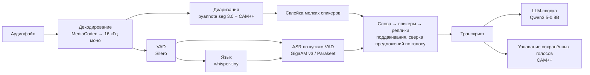

# Архитектура решения

## Контекст

На вход приходит аудиофайл разговора: импорт, «Поделиться» или запись с микрофона. На выходе получаем реплики с говорящим и временем, сводку разговора и экспорт в JSON по схеме кейса. Обработка целиком идёт на телефоне, на CPU. Сети нет ни на одном шаге: разрешения `INTERNET` в манифесте нет, все веса лежат в `assets` APK.

Главные критерии кейса: WER 40, диаризация 25, таймстемпы 10, RTF 10. Поэтому основное время ушло на пайплайн и на стенд, который его меряет. Стенд — это `bench/`: Python-копия пайплайна с той же логикой, что и в Kotlin, плюс генераторы тестовых диалогов и метрики.

## Пайплайн



| Стадия | Что происходит | Код |
| :--- | :--- | :--- |
| Декодирование | `MediaExtractor` + `MediaCodec`. Звук потоково ресемплируется в 16 кГц моно `float`: часовая запись не держит в памяти исходный PCM | `data/audio/MediaCodecAudioSource.kt`, `StreamingResampler.kt` |
| VAD | Silero VAD (мин. тишина 0.3 с). Куски длиннее 20 с режутся по самому тихому 100-мс окну: на сплошном шуме Silero не видит пауз | `SherpaPipeline.vadChunks`, `ChunkSplitter.kt` |
| Язык | whisper-tiny по первым 29 с речи. Если ответ «en», он подтверждается голосованием по 5 кускам из разных мест записи: на реверберации tiny путает русский с английским | `SherpaPipeline.detectLanguage` |
| Диаризация | Сегментация pyannote 3.0 (fp32), эмбеддинги 3D-Speaker CAM++, кластеризация с порогом 0.8. Если пользователь указал число спикеров, оно передаётся как число кластеров | `SherpaPipeline.diarize` |
| Склейка мелких спикеров | Спикер с речью < 6 с (и < 15% всей речи) отдаётся самому похожему по эмбеддингу всей его речи. На живой речи диаризация дробит людей | `Reclusterer.kt` |
| ASR | Русский: GigaAM v3 RNNT с пунктуацией и регистром. Английский: Parakeet TDT 110M. Распознаём каждый кусок VAD, берём таймстемпы токенов и собираем из них слова | `SherpaPipeline.transcribe`, `WordMerger.tokensToWords` |
| Склейка | Слово получает спикера с наибольшим пересечением по времени. Короткие реакции («да», «угу») в зоне наложения уходят перебивающему и становятся отдельной репликой. Предложение (границы даёт пунктуация ASR) сверяется по голосу CAM++ и при явном перевесе переходит к другому спикеру. Реплики режутся на паузах > 3 с и при смене спикера | `WordMerger.kt`, `SentenceRelabeler.kt` |
| LLM | Qwen3.5-0.8B Q4_K_M через llama.cpp: название, краткое содержание и ключевые пункты. Работает с готовым транскриптом и **не меняет его слов**. Длинный транскрипт ужимается под контекст 4096 токенов: начало и конец сохраняются, длина меряется токенизатором модели | `data/llm/LlmSummarizer.kt`, модуль `android/llama/` |
| Голоса | Для каждого спикера считается эмбеддинг CAM++ (до 20 с самых длинных реплик) и сверяется по косинусу с сохранёнными голосами. Если совпало, спикер подписывается именем | `domain/voice/`, `data/voice/` |

Зачем каждое решение и сколько оно дало по метрикам, расписано по пунктам в [`bench/README.md`](../bench/README.md).

### Модели

Все модели лежат в `android/app/src/main/assets/models/` без сжатия. sherpa-onnx читает их прямо из `AssetManager`, `.gguf` при первом запуске копируется в `filesDir` для mmap. Веса скачивает `scripts/fetch_models.sh`, в git их нет.

| Задача | Модель | Размер | Почему она |
| :--- | :--- | ---: | :--- |
| VAD | Silero VAD | 0.6 МБ | Стандарт, RTF 0.009 |
| ASR ru | GigaAM v3 RNNT punct (int8 encoder) | 350 МБ (вместе с en) | Лучший WER с пунктуацией среди 5 проверенных: 7.0% против 8.7–23.6%. Пунктуацию ставит сама, LLM для неё не нужна |
| ASR en | NVIDIA Parakeet TDT 110M (int8) | | WER 14.5% против 23% у Parakeet 0.6B v3, и быстрее |
| Язык | Whisper tiny (int8) | 99 МБ | Только определение языка |
| Сегментация | pyannote segmentation 3.0 (fp32) | 6 МБ | int8 поднимает DER с 6.9% до 11.3% |
| Эмбеддинги | 3D-Speaker CAM++ zh_en advanced | 27 МБ | DER 7.8% ru / 7.6% en. ERes2Net, ResNet34 хуже, TitaNet large даёт −0.6 п.п. при 4× размере |
| LLM | Qwen3.5-0.8B Q4_K_M | 508 МБ | Держит формат ответа и пишет по-русски. Gemma-3-1B ломает формат, Qwen3.5-2B вдвое медленнее при 1.2 ГБ |

Inference backends:
- sherpa-onnx 2.0.1 (ONNX Runtime, CPU, 4 потока);
- llama.cpp b12185 (CPU; arm64 собран с `armv8.2-a+dotprod+fp16`, x86_64 — с AVX2/FMA/F16C).

### Память

Модели загружаются по одной на стадию и освобождаются сразу после неё (`release()` у sherpa-объектов, `close()` у `LlamaModel`). На эмуляторе с 4 ГБ пиковый RSS обработки 20-минутной записи — 306 МБ. LLM (508 МБ весов через mmap) загружается только на время сводки, когда модели ASR и диаризации уже выгружены.

## Приложение

Kotlin, Jetpack Compose, Material 3 Expressive, Hilt, Room, Media3 ExoPlayer. Один модуль `:app` с clean architecture на пакетах и отдельный модуль `:llama` с JNI к llama.cpp.

```
com.lapcevichme.meowscribe/
├── domain/          # чистый Kotlin: модели, контракт TranscriptionPipeline, интерфейсы репозиториев, use case'ы
├── data/
│   ├── pipeline/    # SherpaPipeline (настоящий) и FakePipeline (для разработки UI)
│   ├── llm/         # LlmSummarizer поверх llama.cpp
│   ├── audio/       # декодер, ресемплер, запись с микрофона
│   ├── processing/  # ProcessingManager — очередь обработки
│   ├── db/          # Room: записи, реплики, имена спикеров, голоса
│   ├── export/      # JSON (строгая схема), TXT, SRT
│   └── voice/       # эмбеддинги голоса и их база
├── service/         # Foreground Service: обработка и запись
└── presentation/    # Compose-экраны: главный, обработка, расшифровка, запись, настройки
```

- **Контракт пайплайна.** `TranscriptionPipeline.run(pcm, config): Flow<PipelineEvent>` отдаёт прогресс по стадиям и готовые реплики. UI разрабатывался на `FakePipeline` параллельно с ML-частью, а потом её просто подменили.
- **Обработка вне экрана.** `ProcessingManager` (`@Singleton`) держит последовательную очередь со `StateFlow` прогресса. Foreground Service не даёт системе убить процесс. ViewModel только подписывается, поэтому обработка переживает уход с экрана и поворот.
- **MVVM.** У каждого экрана свой `sealed interface UiState` в `StateFlow`. Разовые события (снекбар, навигация) идут через `Channel`.
- **Ручная правка.** Реплики можно редактировать, делить и объединять, спикеров — переименовывать. Запись можно обработать заново с другими настройками: язык, число спикеров, профиль.

## Зависимости

| Что | Версия |
| :--- | :--- |
| sherpa-onnx (AAR, JitPack) | 2.0.1 |
| llama.cpp (исходники качаются при сборке) | b12185 |
| Android Gradle Plugin / Kotlin / Compose BOM | см. `android/gradle/libs.versions.toml` |
| NDK / CMake | r28 / 3.22.1 |

## Безопасность и приватность

- Разрешения `INTERNET` нет: приложение физически не может отправить аудио или текст.
- Импортированное аудио копируется во внутреннюю папку приложения (`filesDir/audio`), транскрипты лежат в локальной Room-базе. Удаление записи удаляет и файл.
- Эмбеддинги сохранённых голосов хранятся только в базе приложения и удаляются из настроек.
- Экспорт идёт только по явному действию пользователя: в «Загрузки», через «Поделиться» или «Сохранить как…».
